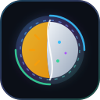

<div align="center">
  

# glowafter

  <p><strong>Cinematic, stutter-free theme transition animations for React & Next.js.</strong></p>
  <p>Engineered with the native View Transitions API, procedural SVG path mathematics, and GSAP canvas fallback.</p>

  <p>
    <a href="https://www.npmjs.com/package/glowafter"></a>
    <a href="https://www.npmjs.com/package/glowafter"></a>
    <a href="https://github.com/MArsalanwarsi/glowafter/blob/main/LICENSE"></a>
    <a href="https://github.com/MArsalanwarsi/glowafter"></a>
    
    
  </p>

  <p>
    <a href="https://glowafter.vercel.app"><strong>Explore Interactive Demonstration Playground »</strong></a>
  </p>
</div>

---

An open-source React animation library that elevates light and dark mode toggles into cinematic visual experiences. Instead of abrupt color flashes or jarring repaints, `glowafter` orchestrates fluid, procedural vector reveals: multi-harmonic ocean tides, Voronoi crystalline fractures, balloon pops, concussive bomb shockwaves, capillary ink blooms, and custom animated GIF alpha masks.

Engineered from the ground up for 60/120 FPS performance, `glowafter` eliminates mobile browser stutter with dedicated multi-touch coordinate tracking (`touches[0]` and `changedTouches[0]`), hardware compositor promotion (`transform: translateZ(0)` and `will-change: clip-path`), and a fallback canvas engine powered by GSAP for environments without native View Transitions support.

Visit the interactive demonstration playground at **[https://glowafter.vercel.app](https://glowafter.vercel.app)** to test all 17 presets, adjust durations in real-time, upload custom GIF masks, and copy production-ready code snippets.

---

## 🌟 Why glowafter?

| The Problem with Conventional Toggles                                                                                                                                                     | The glowafter Solution                                                                                                                                                                       |
| :---------------------------------------------------------------------------------------------------------------------------------------------------------------------------------------- | :------------------------------------------------------------------------------------------------------------------------------------------------------------------------------------------- |
| **Jarring Screen Flash**: Standard dark mode toggles switch class names instantly, producing an unstyled flash of bright light or pitch dark that strains users' eyes.                    | **Smooth Procedural Geometry**: View Transitions API captures snapshots of the previous and incoming theme, morphing between them using continuous mathematical vector paths.                |
| **Mobile Freezing & Skipping**: Generic transition experiments fail on mobile touch screens because `document.hidden` falsely fires during touch events, prematurely skipping animations. | **Dedicated Touch Coordinate Extraction**: Touch events inspect `touches[0]` and `changedTouches[0]`. `document.hidden` skipping is eliminated to ensure touch taps always animate smoothly. |
| **Main-Thread Frame Drops**: Animating full-viewport `clip-path` on standard DOM nodes forces continuous CPU rasterization.                                                               | **Hardware GPU Layer Promotion**: Automatically injects `transform: translateZ(0)` and `will-change: clip-path` onto `::view-transition-old(root)` and `::view-transition-new(root)`.        |
| **Clipping Artifacts & Incomplete Fills**: Hard-coded pixel values fail on high-DPI, ultra-wide, or mobile screens.                                                                       | **Strict Coverage Contracts**: Every preset mathematically guarantees initial coverage `< 0.02` at $t=0$ and final coverage `> 0.99` at $t=1$ across any viewport aspect ratio.              |
| **Cross-Browser Gaps**: Browsers lacking the View Transitions API (e.g. older Safari or Firefox) break or crash.                                                                          | **Dual-Engine Architecture**: Automatically falls back to an off-screen GSAP canvas render pipeline, and honors `prefers-reduced-motion` with instantaneous swaps.                           |

---

## 🚀 Quick start

Use Node.js **18.17+** and any modern package manager:

```bash
# npm
npm install glowafter next-themes

# pnpm
pnpm add glowafter next-themes

# yarn
yarn add glowafter next-themes

# bun
bun add glowafter next-themes
```

### Next.js App Router (2-Step Integration)

#### Step 1: Wrap your layout in `next-themes`

Create `components/theme-provider.tsx`:

```tsx
'use client'

import { ThemeProvider as NextThemesProvider, type ThemeProviderProps } from 'next-themes'
import * as React from 'react'

export function ThemeProvider({ children, ...props }: ThemeProviderProps) {
  return <NextThemesProvider {...props}>{children}</NextThemesProvider>
}
```

Wrap your root layout in `app/layout.tsx`:

```tsx
import { ThemeProvider } from '@/components/theme-provider'

export default function RootLayout({ children }: { children: React.ReactNode }) {
  return (
    <html lang="en" suppressHydrationWarning>
      <body>
        <ThemeProvider attribute="class" defaultTheme="system" enableSystem>
          {children}
        </ThemeProvider>
      </body>
    </html>
  )
}
```

#### Step 2: Add the Animated Theme Toggle Button

Create `components/theme-toggle.tsx`:

```tsx
'use client'

import { Button } from '@/components/ui/button'
import { useModeAnimation, type NaturePresetId } from 'glowafter'
import { Moon, Sun } from 'lucide-react'
import { useTheme } from 'next-themes'

interface ThemeToggleProps {
  presetId?: NaturePresetId
}

export function ThemeToggle({ presetId = 'viral-sweep' }: ThemeToggleProps) {
  const { resolvedTheme, setTheme } = useTheme()
  const { ref, toggleSwitchTheme, mounted, isAnimating } = useModeAnimation({
    presetId,
    duration: 1200,
    isDarkMode: resolvedTheme === 'dark',
    onDarkModeChange: (dark) => setTheme(dark ? 'dark' : 'light'),
  })

  if (!mounted) {
    return <Button variant="outline" size="icon" disabled />
  }

  return (
    <Button
      ref={ref}
      variant="outline"
      size="icon"
      disabled={isAnimating}
      onClick={toggleSwitchTheme}
      aria-label="Toggle theme"
    >
      {resolvedTheme === 'dark' ? <Sun className="h-5 w-5" /> : <Moon className="h-5 w-5" />}
    </Button>
  )
}
```

---

## 🎬 Presets & Capabilities

`glowafter` includes **17 procedural vector presets** and **1 custom GIF alpha mask engine**:

| Family        | Preset ID        | Title                   | Motion Physics & Mathematics                                             | Default Timing |
| :------------ | :--------------- | :---------------------- | :----------------------------------------------------------------------- | :------------- |
| **Cinematic** | `viral-sweep`    | Viral Sweep _(Default)_ | Exponential shockwave expanding radially from the trigger point          | 1.2s           |
| **Cinematic** | `glass-shatter`  | Glass Shatter           | Voronoi crystalline fracture shards radiating outward                    | 1.4s           |
| **Cinematic** | `seaside-waves`  | Seaside Waves           | Multi-harmonic sinusoidal tidal surf with rolling wave crests            | 1.4s           |
| **Cinematic** | `balloon-pop`    | Balloon Pop             | Elastic surface tension stretch followed by a sudden radial rupture      | 1.1s           |
| **Cinematic** | `bomb-drop`      | Bomb Drop               | Descending gravitational arc detonating into a concussive shockwave      | 1.5s           |
| **Cinematic** | `party`          | Celebration Party       | Starburst explosion with dispersing confetti ribbons and streamers       | 1.3s           |
| **Water**     | `waterfall`      | Water Tank              | Central gravitational cascade meeting an ascending rippling waterline    | 1.6s           |
| **Water**     | `silver-rain`    | Rainfall                | High-velocity precipitation streaks accelerating into a splash pool      | 1.5s           |
| **Water**     | `puddle-bloom`   | Puddle Ripple           | Concentric acoustic wave ripples propagating outward                     | 1.3s           |
| **Water**     | `tidal-silk`     | Tidal Silk              | Sweeping diagonal fluid surge with smooth laminar flow                   | 1.4s           |
| **Material**  | `paper-shred`    | Paper Shred             | Vertical micro-ribbons slicing downward at differential velocities       | 1.2s           |
| **Material**  | `paper-tear`     | Paper Tear              | High-frequency ragged diagonal shear fissure propagating across viewport | 1.2s           |
| **Material**  | `wall-break`     | Wall Break              | Heavy masonry blocks dislodging and tumbling under gravity               | 1.4s           |
| **Material**  | `glass-break`    | Glass Fracture          | Spiderweb impact center radiating branching stress fractures             | 1.3s           |
| **Material**  | `woven-blinds`   | Woven Blinds            | Alternating Venetian slat aperture reveal rotating simultaneously        | 1.2s           |
| **Organic**   | `falling-leaves` | Autumn Leaves           | Swirling autumnal foliage with sinusoidal gravitational drift            | 1.6s           |
| **Organic**   | `ink-bloom`      | Ink Bloom               | Multi-capillary viscous fluid diffusion blossom radiating outward        | 1.5s           |
| **Custom**    | `gif`            | Custom GIF Mask         | Dynamic alpha mask driven by user-supplied transparent GIF frames        | User defined   |

---

## 📱 Zero-Stutter Mobile Touch Architecture

Mobile devices are vulnerable to animation skips and dropped frames during viewport transitions. `glowafter` resolves this through three core architectural mechanisms:

```
[Touch / Tap Gesture]
         │
         ▼
[Extract touch coordinates: touches[0] or changedTouches[0]]
         │
         ▼
[Compute Origin (x, y) relative to Viewport]
         │
         ▼
[Promote Compositor Layers: transform: translateZ(0) & will-change: clip-path]
         │
         ▼
[Inject Hardware-Accelerated Dynamic SVG Path Keyframes]
         │
         ▼
[Execute 60/120 FPS View Transition without Main-Thread Blocking]
```

1. **Multi-Touch Coordinate Extraction**: Standard `clientX`/`clientY` properties fail on `TouchEvent`. `glowafter` inspects `event.touches[0]` and `event.changedTouches[0]` to precisely anchor animations at the user's fingertip.
2. **Elimination of `document.hidden` Skipping**: Mobile browsers briefly alter tab focus flags during complex gestures. By eliminating false-positive visibility checks, `glowafter` guarantees every tap triggers its complete visual arc.
3. **Hardware Acceleration CSS Injection**: `glowafter` attaches hardware compositor flags to root view transition pseudo-elements:
   ```css
   ::view-transition-old(root),
   ::view-transition-new(root) {
     transform: translateZ(0);
     will-change: clip-path;
     backface-visibility: hidden;
   }
   ```

---

## 🖼️ Custom GIF Alpha Mask Engine

You can use any transparent animated GIF as a dynamic mask. Transparent pixels preserve the outgoing theme, while opaque pixels reveal the incoming theme:

```tsx
'use client'

import { useModeAnimation } from 'glowafter'

export function CustomGifToggle() {
  const { ref, toggleSwitchTheme } = useModeAnimation({
    presetId: 'gif',
    gifUrl: '/assets/ink-reveal.gif',
    duration: 2200,
  })

  return (
    <button ref={ref} onClick={toggleSwitchTheme} className="px-4 py-2 border rounded-md">
      Switch Theme with Custom Mask
    </button>
  )
}
```

---

## ⚡ Direct Function API (`performSwitch`)

For vanilla JavaScript, state machines, Web Components, or custom canvas triggers outside of React components:

```typescript
import { performSwitch } from 'glowafter'

buttonElement.addEventListener('click', async (event) => {
  await performSwitch({
    presetId: 'glass-shatter',
    trigger: event, // Pass MouseEvent or TouchEvent for origin calculations
    duration: 1400,
    updateTheme: async () => {
      document.documentElement.classList.toggle('dark')
    },
  })
})
```

---

## 📚 API Reference

### `useModeAnimation(options)`

Primary React hook for wiring theme toggles.

#### Parameters

| Option             | Type                      | Default         | Description                                                                      |
| :----------------- | :------------------------ | :-------------- | :------------------------------------------------------------------------------- |
| `presetId`         | `NaturePresetId`          | `'viral-sweep'` | The ID of the preset to animate (or `'gif'`).                                    |
| `duration`         | `number`                  | Preset default  | Duration in milliseconds (clamped between 0 and 15,000ms).                       |
| `easing`           | `string`                  | `'linear'`      | CSS transition easing function.                                                  |
| `gifUrl`           | `string`                  | `undefined`     | Absolute or relative URL to transparent GIF (required when `presetId: 'gif'`).   |
| `isDarkMode`       | `boolean`                 | `undefined`     | Controlled dark mode state. When omitted, automatically inspects DOM class list. |
| `onDarkModeChange` | `(dark: boolean) => void` | `undefined`     | Callback invoked when the theme toggle state changes.                            |
| `globalClassName`  | `string`                  | `'dark'`        | HTML class toggled on `document.documentElement`.                                |

#### Return Value

| Field               | Type                                                              | Description                                                                    |
| :------------------ | :---------------------------------------------------------------- | :----------------------------------------------------------------------------- |
| `ref`               | `React.RefObject`                                                 | Optional ref to attach to the trigger button for automatic origin coordinates. |
| `toggleSwitchTheme` | `(event?: React.MouseEvent \| React.TouchEvent) => Promise<void>` | Async function that triggers the transition.                                   |
| `isDarkMode`        | `boolean`                                                         | Current theme state.                                                           |
| `mounted`           | `boolean`                                                         | `true` once mounted on client (guards against SSR hydration mismatch).         |
| `isAnimating`       | `boolean`                                                         | `true` while the theme transition is in motion.                                |

---

## 🗂️ Project Structure

```text
glowafter/
├── src/
│   ├── index.ts               # Core engine, useModeAnimation hook, performSwitch, View Transitions orchestrator
│   ├── presets/
│   │   ├── nature.ts          # 17 procedural path recipes & GIF mask specification
│   │   ├── types.ts           # TypeScript interfaces, PresetRecipe, ModeAnimationOptions
│   │   └── index.ts           # Comprehensive preset registry & catalog exports
├── example/                   # Interactive Next.js 16 demonstration playground
│   ├── src/app/
│   │   ├── page.tsx           # Playground UI, live switcher, code generator, preset gallery
│   │   ├── layout.tsx         # Next.js App Router root layout & metadata
│   │   └── globals.css        # Theme styles & animations
│   └── components/            # MotionArtwork, UI primitives, and code viewers
├── tests/
│   ├── run-all.ts             # 1,621 unit tests covering 4 tiers (coverage, bounds, cross-features, canvas)
│   └── browser/motion.spec.ts # Playwright browser test suite (58 multi-viewport tests)
└── scripts/
    ├── release.sh             # Automated GitHub Actions npm release orchestrator
    └── verify-public-install.sh # Registry propagation verification runner
```

---

## 🌐 Browser Compatibility Matrix

| Browser                           | Engine             | Transition Mode                               | Frame Rate    |
| :-------------------------------- | :----------------- | :-------------------------------------------- | :------------ |
| **Chrome / Edge / Opera / Brave** | Chromium 111+      | Native View Transitions API                   | 60 – 120 FPS  |
| **Safari / iOS WebKit**           | WebKit 18+ / Older | GSAP Canvas Fallback                          | 60 FPS        |
| **Firefox**                       | Gecko              | GSAP Canvas Fallback                          | 60 FPS        |
| **Reduced Motion Preference**     | All Browsers       | Instant state swap (`prefers-reduced-motion`) | Instantaneous |

---

## 🧪 Testing & Verification

Every build is validated against a rigorous two-layer testing pipeline:

```bash
# Run unit & mathematical coverage test suite (1,621 tests across 4 tiers)
npm test

# Run Playwright browser test suite (58 tests across Mobile, Tablet, Desktop)
npm run test:browser

# Verify production bundle compilation
npm run build
```

---

## 📄 License

MIT © [Muhammad Arsalan Warsi](https://github.com/MArsalanwarsi)
