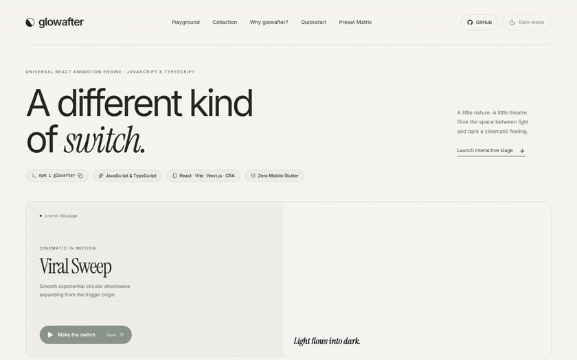

<div align="center">
  

# glowafter Playground

  <p><strong>Interactive demonstration portal and live testing playground for glowafter.</strong></p>
  <p>Engineered for React in both JavaScript & TypeScript variants across Vite, Next.js, CRA, and Remix.</p>

  <p>
    <a href="https://glowafter.vercel.app"></a>
    <a href="https://www.npmjs.com/package/glowafter"></a>
    <a href="https://github.com/MArsalanwarsi/glowafter"></a>
    
    
  </p>
  <p>
    <a href="https://glowafter.vercel.app">
      
    </a>
  </p>
</div>

---

This is the official demonstration playground for **`glowafter`**, showcasing all 17 procedural theme transition presets and the custom GIF alpha mask engine in action.

## 🌟 Universal Compatibility

- **JavaScript & TypeScript**: Ready to drop into `.jsx`, `.js`, `.tsx`, and `.ts` files with zero build-tool configuration.
- **Framework Agnostic**: Runs in any React setup — Vite, Next.js (App & Pages Router), Remix, Astro, or Create React App.
- **Zero-Dependency Core**: Operates standalone with automatic `localStorage` and `classList` synchronization, or plugs into `next-themes` and `shadcn/ui`.

---

## 🚀 Getting Started

### 1. Install Dependencies

From the repository root:

```bash
npm install
npm --prefix example install
```

### 2. Start the Development Server

```bash
npm --prefix example run dev
```

Open [http://localhost:3000](http://localhost:3000) (or your designated port) in your browser.

---

## 🛠️ Building for Production

The playground is configured for static HTML export (`output: 'export'`), ready to deploy to Vercel, Netlify, or GitHub Pages.

```bash
# Production export to example/out
npm --prefix example run build
```

When building for GitHub Pages, provide `GITHUB_PAGES=true` to automatically prefix assets with `/glowafter`:

```bash
GITHUB_PAGES=true npm --prefix example run build
```

---

## 🧪 Browser E2E Testing with Playwright

Run the Playwright test suite to verify theme transitions across multiple viewports:

```bash
# Run 58 tests across Mobile (390x844), Tablet (768x1024), and Desktop (1440x900)
npm run test:browser
```

---

## 📄 License

MIT © [Muhammad Arsalan Warsi](https://github.com/MArsalanwarsi)
